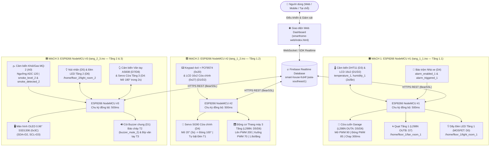

# SmartHouse V4 (Final) — Sơ Đồ Workflow & Đấu Nối Phần Cứng

Hệ thống **SmartHouse V4 (`New/SmartHouse_Hardware/`)** sử dụng **3 mạch vi điều khiển `ESP8266 NodeMCU (ESP-12E)`** đồng bộ trực tiếp với **Firebase Realtime Database** (`smart-house-fcd4f`) qua giao thức HTTPS REST (`BearSSL::WiFiClientSecure`).

---

## 1. Sơ đồ Workflow Tổng Thể Hệ Thống

---

## 2. Sơ Đồ Đấu Nối Chi Tiết Từng Mạch (`ESP8266 NodeMCU`)

### 🟧 MẠCH 1: Tầng 1.1 (`tang_1_1.ino`) — Nhà xe, Quạt, Đèn T1, Khí hậu & Chống trộm

| Chân ESP8266 | GPIO | Thiết bị ngoại vi | Chân trên Module | Đường dẫn Firebase |
| :---: | :---: | :--- | :--- | :--- |
| **`D0`** | `GPIO 16` | **Dãy đèn LED Tầng 1** | Chân `SIG` / `IN` (Module MOSFET) | `/home/floor_1/light_room_1` |
| **`D1`** | `GPIO 5` | **Màn hình LCD 16x2 I2C** | Chân `SCL` (Địa chỉ `0x27`) | *(Hiển thị tại chỗ)* |
| **`D2`** | `GPIO 4` | **Màn hình LCD 16x2 I2C** | Chân `SDA` (Địa chỉ `0x27`) | *(Hiển thị tại chỗ)* |
| **`D3`** | `GPIO 0` | **Cảm biến Nhiệt/Ẩm `DHT11`** | Chân `DATA` / `OUT` (`VCC` nối `3V3`) | `/home/floor_1/temperature_1` `/home/floor_1/humidity_1` |
| **`D4`** | `GPIO 2` | **Cảm biến Chống trộm Nhà xe** | Chân `DO` / `OUT` (Digital) | `/home/floor_1/alarm_enabled_1` `/home/floor_1/alarm_triggered_1` |
| **`D5`** | `GPIO 14` | **Motor Cửa cuốn Garage (Mở)** | Chân `IN1` (`L298N #1` - Kênh A `OUT1/2`) | `/home/floor_1/garage/command` |
| **`D6`** | `GPIO 12` | **Motor Cửa cuốn Garage (Đóng)** | Chân `IN2` (`L298N #1` - Kênh A `OUT1/2`) | `/home/floor_1/garage/status` |
| **`D7`** | `GPIO 13` | **Quạt làm mát Tầng 1** | Chân `IN3` (`L298N #1` - Kênh B `OUT3/4`, `IN4` nối `GND`) | `/home/floor_1/fan_room_1` |
| **`VIN` / `3V3` / `GND`** | Nguồn | `LCD` dùng `VIN (5V)`; `DHT11` & `IR` dùng `3V3`; **nối chung `GND`** với `L298N #1` và nguồn ngoài | | |

---

### 🟩 MẠCH 2: Tầng 1.2 (`tang_1_2.ino`) — Khóa Cửa chính & Thang máy 3 Tầng

| Chân ESP8266 | GPIO | Thiết bị ngoại vi | Chân trên Module | Đường dẫn Firebase |
| :---: | :---: | :--- | :--- | :--- |
| **`D1`** | `GPIO 5` | **LCD 16x2 (`0x27`) + Keypad `PCF8574` (`0x20`)** | Chân `SCL` chung của cả 2 module | *(Nhập mật khẩu `"111#"` tại chỗ)* |
| **`D2`** | `GPIO 4` | **LCD 16x2 (`0x27`) + Keypad `PCF8574` (`0x20`)** | Chân `SDA` chung của cả 2 module | *(Nhập mật khẩu `"111#"` tại chỗ)* |
| **`D4`** | `GPIO 2` | **Servo `SG90` Khóa Cửa chính** | Dây **Cam/Vàng** (`PWM`: Đóng `100°`, Mở `20°` trong `3s`) | `/home/floor_1/door_opened_1` `/home/floor_1/light_room_1` |
| **`D5`** | `GPIO 14` | **Motor Thang máy (Đi LÊN)** | Chân `IN1` (`L298N #2` - `PWM 200`) | `/home/elevator/target_floor` |
| **`D6`** | `GPIO 12` | **Motor Thang máy (Đi XUỐNG)** | Chân `IN2` (`L298N #2` - `PWM 70`) | `/home/elevator/current_floor` `/home/elevator/status` |
| **`D0, D3, D7`** | Tùy chọn | **Công tắc hành trình Tầng 1, 2, 3** | Nối `GND` khi tác động (`USE_LIMIT_SWITCHES`) | |
| **`VIN` / `5V` / `GND`** | Nguồn | Cấp `5V` cho `LCD 16x2` và dây Đỏ `Servo SG90`; giữ Jumper `ENA` trên `L298N #2`; **nối chung `GND`** | | |

---

### 🟦 MẠCH 3: Tầng 2 & 3 (`tang_2_3.ino`) — Báo cháy `MQ-2`, Đèn T2, `OLED` & Cửa Vân Tay `AS608`

| Chân ESP8266 | GPIO | Thiết bị ngoại vi | Chân trên Module | Đường dẫn Firebase |
| :---: | :---: | :--- | :--- | :--- |
| **`A0`** | `ADC0` | **[Tầng 2] Cảm biến Khói/Gas `MQ-2`** | Chân `AO` (Analog Output, ngưỡng `120`) | `/home/floor_2/smoke_level_2` `/home/floor_2/smoke_detected_2` |
| **`D1`** | `GPIO 5` | **[Chung] Còi báo `Buzzer 5V`** | Cực Dương (`+`) của còi; cực Âm (`-`) nối `GND` | `/home/floor_2/buzzer_mute_2` |
| **`D2`** | `GPIO 4` | **[Tầng 2] Màn hình `OLED 0.96"` (`0x3C`)** | Chân `SDA` | *(Hiển thị tại chỗ)* |
| **`D3`** | `GPIO 0` | **[Tầng 2] Màn hình `OLED 0.96"` (`0x3C`)** | Chân `SCL` | *(Hiển thị tại chỗ)* |
| **`D4`** | `GPIO 2` | **[Tầng 3] Servo `SG90` Cửa Vân Tay** | Dây **Cam/Vàng** (`PWM`: Mở `180°` trong `2s`, Đóng `0°`) | `/home/door_status` |
| **`D5`** | `GPIO 14` | **[Tầng 2] Nút nhấn vật lý Đèn T2** | Chân 1 nút nhấn (Chân 2 nối `GND`) | `/home/floor_2/light_room_2` |
| **`D6`** | `GPIO 12` | **[Tầng 2] Đèn LED / Relay Tầng 2** | Chân `SIG` / `IN` của MOSFET hoặc Relay | `/home/floor_2/light_room_2` |
| **`D7`** | `GPIO 13` | **[Tầng 3] Cảm biến Vân tay `AS608`** | Nối vào chân **`TX`** của cảm biến `AS608` (`57600` baud) | *(Quét vân tay 150ms/lần)* |
| **`D8`** | `GPIO 15` | **[Tầng 3] Cảm biến Vân tay `AS608`** | Nối vào chân **`RX`** của cảm biến `AS608` (`57600` baud) | *(Hỗ trợ lệnh `ENROLL <id>`)* |
| **`3V3` / `5V` / `GND`** | Nguồn | `AS608` & `OLED` cấp **`3V3`**; `MQ-2` & `Servo SG90` cấp **`5V`**; **nối chung `GND`** toàn mạch | | |
